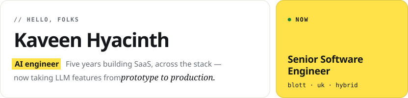
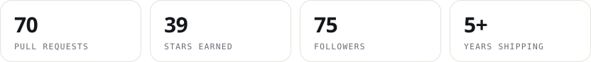
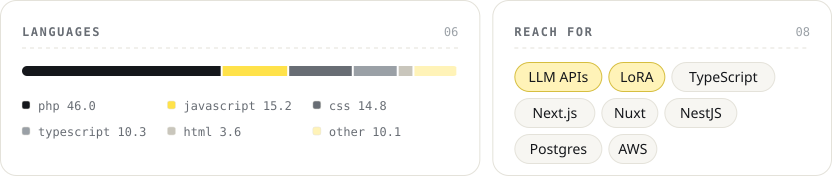
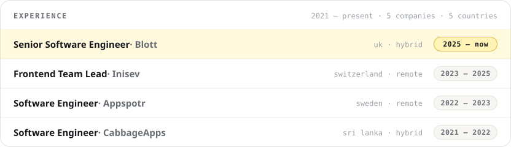

<!-- Images are rendered by .github/workflows/profile.yml from scripts/render-profile.mjs. Edit copy in CONTENT there. -->

<picture>
  <source media="(prefers-color-scheme: dark)" srcset="./assets/hero-dark.svg">
  
</picture>

<picture>
  <source media="(prefers-color-scheme: dark)" srcset="./assets/stats-dark.svg">
  
</picture>

<picture>
  <source media="(prefers-color-scheme: dark)" srcset="./assets/langs-stack-dark.svg">
  
</picture>

<picture>
  <source media="(prefers-color-scheme: dark)" srcset="./assets/experience-dark.svg">
  
</picture>

<picture>
  <source media="(prefers-color-scheme: dark)" srcset="./assets/footer-dark.svg">
  
</picture>

  <a href="mailto:mailme@kaveenhyacinth.com"><picture><source media="(prefers-color-scheme: dark)" srcset="./assets/btn-email-dark.svg"></picture></a>
  <a href="https://www.linkedin.com/in/kaveen-hyacinth/"><picture><source media="(prefers-color-scheme: dark)" srcset="./assets/btn-linkedin-dark.svg"></picture></a>

